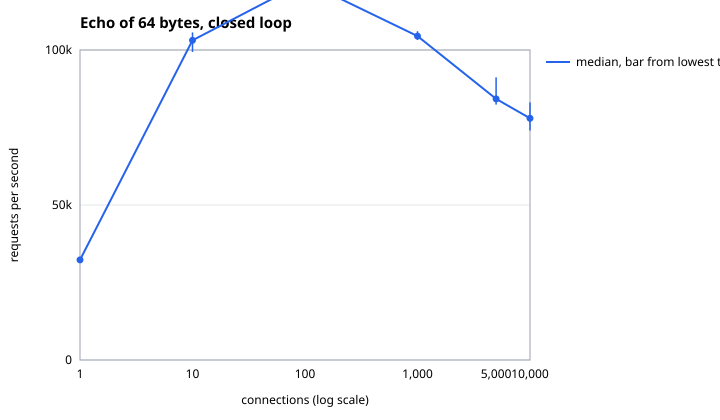

# Benchmark report: connections

Generated by `benchmarks/analyze.py` from the raw results in `runs/`.

## Where these numbers come from

| | |
| --- | --- |
| Date (UTC) | 2026-11-15T07:48:42+00:00 |
| Machine | Apple M1, 8 cores, arm64 |
| OS | macOS 26.6.2 (Darwin 25.6.0) |
| Power | Battery Power |
| Compiler | AppleClang 17.0.0.17000013 |
| Build | Release, flags `-O3 -DNDEBUG`, sanitizer none |
| Commit | dafec023e3f9a80b495aa37a27803d6085a9c4ee |
| Server waits with | poll |
| Client waits with | poll |
| Each cell | 5 runs of 5 s after 2 s of warm-up, fresh server each run |
| Client threads | 1, 4 |
| CPU pinning | server: not pinned, client: not pinned |
| Command | `benchmarks/run.py --build build-release --suite connections` |

## Results

Throughput is the median over the runs, with the lowest and highest run
beside it. Latencies are the median over the runs of each run's
percentile. A percentile is left out when a run had too few samples for it.

| Cell | Requests/s | Lowest to highest | p50 | p99 | p99.9 | Worst | MiB/s | Not answered |
| --- | ---: | --- | ---: | ---: | ---: | ---: | ---: | ---: |
| echo-64B-1c | 32,300 | 32,090 to 32,538 | 30 µs | 57 µs | 90 µs | 1.18 ms | 4.7 | 0 |
| echo-64B-10c | 103,134 | 99,372 to 105,675 | 92 µs | 197 µs | 283 µs | 54.05 ms | 15.0 | 0 |
| echo-64B-100c | 122,046 | 121,382 to 125,195 | 778 µs | 1.55 ms | 2.02 ms | 3.36 ms | 17.7 | 0 |
| echo-64B-1000c | 104,476 | 103,234 to 106,070 | 9.37 ms | 16.12 ms | 20.05 ms | 34.57 ms | 15.1 | 0 |
| echo-64B-5000c | 84,219 | 82,377 to 91,148 | 57.67 ms | 92.27 ms | 102.24 ms | 154.40 ms | 12.2 | 0 |
| echo-64B-10000c | 77,953 | 74,020 to 83,092 | 124.78 ms | 205.52 ms | 257.95 ms | 417.36 ms | 11.3 | 739 |

Latency in a closed loop is counted from when a request was sent. In an
open loop it is counted from when the request was due, so it includes any
time the request waited to be sent.

## The server while it was measured

| Cell | CPU (cores) | Workers busy | Memory | Deepest queue | Switches/s forced | Switches/s by choice |
| --- | ---: | ---: | ---: | ---: | ---: | ---: |
| echo-64B-1c | 0.55 | 1% | 2 MiB | 1 | n/a | n/a |
| echo-64B-10c | 1.29 | 3% | 2 MiB | 2 | n/a | n/a |
| echo-64B-100c | 1.36 | 2% | 2 MiB | 12 | n/a | n/a |
| echo-64B-1000c | 1.28 | 2% | 2 MiB | 0 | n/a | n/a |
| echo-64B-5000c | 1.24 | 2% | 5 MiB | 0 | n/a | n/a |
| echo-64B-10000c | 1.17 | 2% | 8 MiB | 0 | n/a | n/a |

CPU is in cores: 1.00 is one core used all the time. Context switches
are only available on Linux.

## Was the client the limit?

**Yes, in these cells.** Their numbers say what the client could do,
not what the server could do:

- echo-64B-5000c: 3 of 5 runs, client CPU per thread 0.87.
- echo-64B-10000c: 3 of 5 runs, client CPU per thread 0.86.
- echo-64B-1000c: 4 of 5 runs, client CPU per thread 0.86.

| Cell | Client threads | Client CPU per thread |
| --- | ---: | ---: |
| echo-64B-1c | 1 | 0.23 |
| echo-64B-10c | 4 | 0.30 |
| echo-64B-100c | 4 | 0.76 |
| echo-64B-1000c | 4 | 0.86 |
| echo-64B-5000c | 4 | 0.87 |
| echo-64B-10000c | 4 | 0.86 |

## Plots

