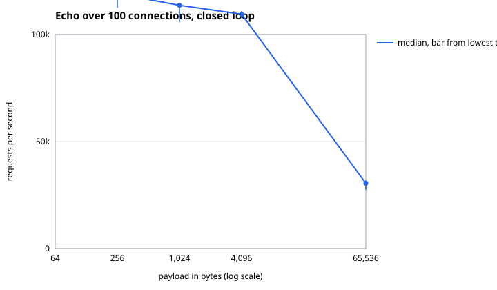

# Benchmark report: payloads

Generated by `benchmarks/analyze.py` from the raw results in `runs/`.

## Where these numbers come from

| | |
| --- | --- |
| Date (UTC) | 2026-11-15T07:52:23+00:00 |
| Machine | Apple M1, 8 cores, arm64 |
| OS | macOS 26.6.2 (Darwin 25.6.0) |
| Power | Battery Power |
| Compiler | AppleClang 17.0.0.17000013 |
| Build | Release, flags `-O3 -DNDEBUG`, sanitizer none |
| Commit | dafec023e3f9a80b495aa37a27803d6085a9c4ee plus uncommitted changes |
| Server waits with | poll |
| Client waits with | poll |
| Each cell | 5 runs of 5 s after 2 s of warm-up, fresh server each run |
| Client threads | 4 |
| CPU pinning | server: not pinned, client: not pinned |
| Command | `benchmarks/run.py --build build-release --suite payloads` |

## Results

Throughput is the median over the runs, with the lowest and highest run
beside it. Latencies are the median over the runs of each run's
percentile. A percentile is left out when a run had too few samples for it.

| Cell | Requests/s | Lowest to highest | p50 | p99 | p99.9 | Worst | MiB/s | Not answered |
| --- | ---: | --- | ---: | ---: | ---: | ---: | ---: | ---: |
| echo-64B-100c | 121,232 | 119,595 to 122,624 | 786 µs | 1.57 ms | 2.05 ms | 3.34 ms | 17.6 | 0 |
| echo-256B-100c | 119,064 | 112,469 to 121,418 | 799 µs | 1.56 ms | 1.97 ms | 94.07 ms | 60.9 | 0 |
| echo-1024B-100c | 113,659 | 105,670 to 114,312 | 819 µs | 1.87 ms | 5.93 ms | 50.74 ms | 224.6 | 0 |
| echo-4096B-100c | 109,494 | 107,684 to 110,906 | 877 µs | 1.67 ms | 2.11 ms | 3.53 ms | 857.9 | 0 |
| echo-65536B-100c | 30,491 | 27,486 to 31,826 | 3.05 ms | 7.11 ms | 12.12 ms | 94.22 ms | 3812.1 | 0 |

Latency in a closed loop is counted from when a request was sent. In an
open loop it is counted from when the request was due, so it includes any
time the request waited to be sent.

## The server while it was measured

| Cell | CPU (cores) | Workers busy | Memory | Deepest queue | Switches/s forced | Switches/s by choice |
| --- | ---: | ---: | ---: | ---: | ---: | ---: |
| echo-64B-100c | 1.34 | 2% | 2 MiB | 11 | n/a | n/a |
| echo-256B-100c | 1.34 | 3% | 2 MiB | 2 | n/a | n/a |
| echo-1024B-100c | 1.31 | 3% | 2 MiB | 11 | n/a | n/a |
| echo-4096B-100c | 1.37 | 4% | 3 MiB | 1 | n/a | n/a |
| echo-65536B-100c | 1.27 | 7% | 29 MiB | 0 | n/a | n/a |

CPU is in cores: 1.00 is one core used all the time. Context switches
are only available on Linux.

## Was the client the limit?

No run was flagged. In a closed loop a run is flagged when the client's
threads use 85% or more of their time. In an open loop it is flagged
when more than 1% of requests were sent over a millisecond late.

| Cell | Client threads | Client CPU per thread |
| --- | ---: | ---: |
| echo-64B-100c | 4 | 0.75 |
| echo-256B-100c | 4 | 0.74 |
| echo-1024B-100c | 4 | 0.71 |
| echo-4096B-100c | 4 | 0.73 |
| echo-65536B-100c | 4 | 0.41 |

## Plots

