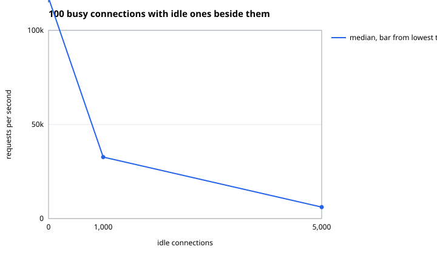

# Benchmark report: mix

Generated by `benchmarks/analyze.py` from the raw results in `runs/`.

## Where these numbers come from

| | |
| --- | --- |
| Date (UTC) | 2026-11-15T07:57:09+00:00 |
| Machine | Apple M1, 8 cores, arm64 |
| OS | macOS 26.6.2 (Darwin 25.6.0) |
| Power | Battery Power |
| Compiler | AppleClang 17.0.0.17000013 |
| Build | Release, flags `-O3 -DNDEBUG`, sanitizer none |
| Commit | dafec023e3f9a80b495aa37a27803d6085a9c4ee plus uncommitted changes |
| Server waits with | poll |
| Client waits with | poll |
| Each cell | 5 runs of 5 s after 2 s of warm-up, fresh server each run |
| Client threads | 4 |
| CPU pinning | server: not pinned, client: not pinned |
| Command | `benchmarks/run.py --build build-release --suite mix` |

## Results

Throughput is the median over the runs, with the lowest and highest run
beside it. Latencies are the median over the runs of each run's
percentile. A percentile is left out when a run had too few samples for it.

| Cell | Requests/s | Lowest to highest | p50 | p99 | p99.9 | Worst | MiB/s | Not answered |
| --- | ---: | --- | ---: | ---: | ---: | ---: | ---: | ---: |
| echo-64B-100c-0idle | 117,223 | 114,858 to 120,316 | 807 µs | 1.61 ms | 2.07 ms | 18.99 ms | 17.0 | 0 |
| echo-64B-100c-1000idle | 32,676 | 32,388 to 32,991 | 3.11 ms | 5.37 ms | 6.13 ms | 9.50 ms | 4.7 | 0 |
| echo-64B-100c-5000idle | 6,085 | 5,931 to 6,699 | 16.06 ms | 25.30 ms | 27.39 ms | 37.44 ms | 0.9 | 0 |

Latency in a closed loop is counted from when a request was sent. In an
open loop it is counted from when the request was due, so it includes any
time the request waited to be sent.

## The server while it was measured

| Cell | CPU (cores) | Workers busy | Memory | Deepest queue | Switches/s forced | Switches/s by choice |
| --- | ---: | ---: | ---: | ---: | ---: | ---: |
| echo-64B-100c-0idle | 1.38 | 2% | 2 MiB | 6 | n/a | n/a |
| echo-64B-100c-1000idle | 1.12 | 1% | 2 MiB | 5 | n/a | n/a |
| echo-64B-100c-5000idle | 1.01 | 0% | 4 MiB | 0 | n/a | n/a |

CPU is in cores: 1.00 is one core used all the time. Context switches
are only available on Linux.

## Was the client the limit?

**Yes, in these cells.** Their numbers say what the client could do,
not what the server could do:

- echo-64B-100c-5000idle: 4 of 5 runs, client CPU per thread 0.89.

| Cell | Client threads | Client CPU per thread |
| --- | ---: | ---: |
| echo-64B-100c-0idle | 4 | 0.75 |
| echo-64B-100c-1000idle | 4 | 0.84 |
| echo-64B-100c-5000idle | 4 | 0.89 |

## Plots

