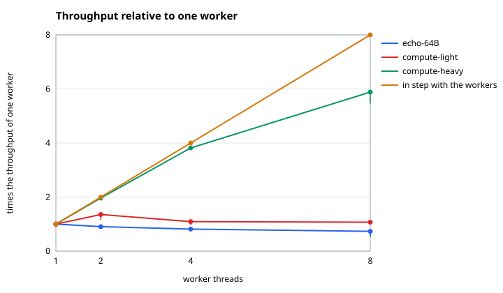

# Benchmark report: workers

Generated by `benchmarks/analyze.py` from the raw results in `runs/`.

## Where these numbers come from

| | |
| --- | --- |
| Date (UTC) | 2026-11-15T07:58:57+00:00 |
| Machine | Apple M1, 8 cores, arm64 |
| OS | macOS 26.6.2 (Darwin 25.6.0) |
| Power | Battery Power |
| Compiler | AppleClang 17.0.0.17000013 |
| Build | Release, flags `-O3 -DNDEBUG`, sanitizer none |
| Commit | dafec023e3f9a80b495aa37a27803d6085a9c4ee plus uncommitted changes |
| Server waits with | poll |
| Client waits with | poll |
| Each cell | 5 runs of 5 s after 2 s of warm-up, fresh server each run |
| Client threads | 4 |
| CPU pinning | server: not pinned, client: not pinned |
| Command | `benchmarks/run.py --build build-release --suite workers` |

## Results

Throughput is the median over the runs, with the lowest and highest run
beside it. Latencies are the median over the runs of each run's
percentile. A percentile is left out when a run had too few samples for it.

| Cell | Requests/s | Lowest to highest | p50 | p99 | p99.9 | Worst | MiB/s | Not answered |
| --- | ---: | --- | ---: | ---: | ---: | ---: | ---: | ---: |
| echo-64B-1w | 130,807 | 122,137 to 132,773 | 733 µs | 1.45 ms | 1.83 ms | 59.54 ms | 19.0 | 0 |
| echo-64B-2w | 118,626 | 114,300 to 121,180 | 799 µs | 1.65 ms | 3.21 ms | 58.53 ms | 17.2 | 0 |
| echo-64B-4w | 106,829 | 99,415 to 109,338 | 885 µs | 1.79 ms | 2.65 ms | 58.74 ms | 15.5 | 0 |
| echo-64B-8w | 95,912 | 68,673 to 99,293 | 987 µs | 1.98 ms | 2.57 ms | 61.10 ms | 13.9 | 0 |
| compute-light-1w | 88,232 | 86,713 to 90,538 | 1.09 ms | 1.79 ms | 3.28 ms | 49.56 ms | 8.4 | 0 |
| compute-light-2w | 119,499 | 101,846 to 121,522 | 803 µs | 1.56 ms | 3.01 ms | 70.33 ms | 11.4 | 0 |
| compute-light-4w | 96,297 | 86,164 to 105,458 | 918 µs | 2.56 ms | 6.23 ms | 128.27 ms | 9.2 | 0 |
| compute-light-8w | 94,398 | 90,550 to 98,750 | 979 µs | 2.28 ms | 3.05 ms | 52.96 ms | 9.0 | 0 |
| compute-heavy-1w | 75 | 74 to 76 | 1.33 s | n/a | n/a | 1.40 s | 0.1 | 0 |
| compute-heavy-2w | 147 | 140 to 149 | 671.09 ms | n/a | n/a | 812.77 ms | 0.1 | 0 |
| compute-heavy-4w | 286 | 281 to 286 | 350.22 ms | 356.44 ms | n/a | 379.67 ms | 0.3 | 0 |
| compute-heavy-8w | 441 | 409 to 444 | 226.49 ms | 253.76 ms | n/a | 430.78 ms | 0.4 | 0 |

Latency in a closed loop is counted from when a request was sent. In an
open loop it is counted from when the request was due, so it includes any
time the request waited to be sent.

## The server while it was measured

| Cell | CPU (cores) | Workers busy | Memory | Deepest queue | Switches/s forced | Switches/s by choice |
| --- | ---: | ---: | ---: | ---: | ---: | ---: |
| echo-64B-1w | 1.16 | 8% | 2 MiB | 8 | n/a | n/a |
| echo-64B-2w | 1.26 | 5% | 2 MiB | 10 | n/a | n/a |
| echo-64B-4w | 1.37 | 2% | 2 MiB | 5 | n/a | n/a |
| echo-64B-8w | 1.39 | 1% | 2 MiB | 32 | n/a | n/a |
| compute-light-1w | 1.82 | 98% | 2 MiB | 83 | n/a | n/a |
| compute-light-2w | 2.36 | 76% | 2 MiB | 40 | n/a | n/a |
| compute-light-4w | 2.12 | 34% | 2 MiB | 39 | n/a | n/a |
| compute-light-8w | 2.17 | 15% | 2 MiB | 10 | n/a | n/a |
| compute-heavy-1w | 1.00 | 100% | 2 MiB | 99 | n/a | n/a |
| compute-heavy-2w | 1.99 | 100% | 2 MiB | 98 | n/a | n/a |
| compute-heavy-4w | 4.05 | 100% | 2 MiB | 96 | n/a | n/a |
| compute-heavy-8w | 7.25 | 100% | 2 MiB | 92 | n/a | n/a |

CPU is in cores: 1.00 is one core used all the time. Context switches
are only available on Linux.

## Was the client the limit?

No run was flagged. In a closed loop a run is flagged when the client's
threads use 85% or more of their time. In an open loop it is flagged
when more than 1% of requests were sent over a millisecond late.

| Cell | Client threads | Client CPU per thread |
| --- | ---: | ---: |
| echo-64B-1w | 4 | 0.81 |
| echo-64B-2w | 4 | 0.78 |
| echo-64B-4w | 4 | 0.76 |
| echo-64B-8w | 4 | 0.72 |
| compute-light-1w | 4 | 0.77 |
| compute-light-2w | 4 | 0.78 |
| compute-light-4w | 4 | 0.67 |
| compute-light-8w | 4 | 0.68 |
| compute-heavy-1w | 4 | 0.00 |
| compute-heavy-2w | 4 | 0.00 |
| compute-heavy-4w | 4 | 0.01 |
| compute-heavy-8w | 4 | 0.01 |

## Plots

