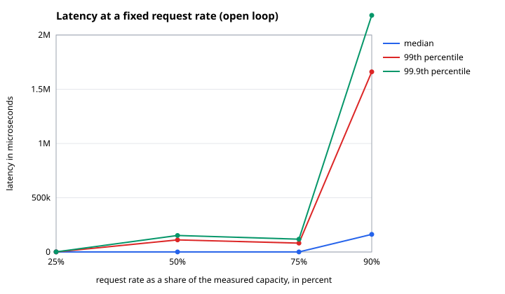

# Benchmark report: latency

Generated by `benchmarks/analyze.py` from the raw results in `runs/`.

## Where these numbers come from

| | |
| --- | --- |
| Date (UTC) | 2026-11-15T08:06:06+00:00 |
| Machine | Apple M1, 8 cores, arm64 |
| OS | macOS 26.6.2 (Darwin 25.6.0) |
| Power | Battery Power |
| Compiler | AppleClang 17.0.0.17000013 |
| Build | Release, flags `-O3 -DNDEBUG`, sanitizer none |
| Commit | dafec023e3f9a80b495aa37a27803d6085a9c4ee plus uncommitted changes |
| Server waits with | poll |
| Client waits with | poll |
| Each cell | 5 runs of 5 s after 2 s of warm-up, fresh server each run |
| Client threads | 4 |
| CPU pinning | server: not pinned, client: not pinned |
| Command | `benchmarks/run.py --build build-release --suite latency` |

## Results

Throughput is the median over the runs, with the lowest and highest run
beside it. Latencies are the median over the runs of each run's
percentile. A percentile is left out when a run had too few samples for it.

| Cell | Requests/s | Lowest to highest | p50 | p99 | p99.9 | Worst | MiB/s | Not answered |
| --- | ---: | --- | ---: | ---: | ---: | ---: | ---: | ---: |
| echo-64B-100c-capacity | 108,572 | 104,418 to 112,028 | 868 µs | 1.80 ms | 2.62 ms | 55.84 ms | 15.7 | 0 |
| echo-64B-100c-25pct | 27,135 | 27,098 to 27,154 | 420 µs | 881 µs | 1.08 ms | 122.37 ms | 3.9 | 0 |
| echo-64B-100c-50pct | 54,253 | 54,233 to 55,183 | 553 µs | 111.67 ms | 152.04 ms | 242.49 ms | 7.9 | 0 |
| echo-64B-100c-75pct | 81,359 | 81,347 to 82,139 | 758 µs | 81.79 ms | 117.96 ms | 254.39 ms | 11.8 | 0 |
| echo-64B-100c-90pct | 90,187 | 79,860 to 96,985 | 162.53 ms | 1.66 s | 2.18 s | 3.16 s | 13.1 | 0 |

Latency in a closed loop is counted from when a request was sent. In an
open loop it is counted from when the request was due, so it includes any
time the request waited to be sent.

Open-loop cells and the rate they asked for:

- echo-64B-100c-90pct: asked for 97,715 per second, 313,407 requests were due and never sent.
- echo-64B-100c-50pct: asked for 54,286 per second, 0 requests were due and never sent.
- echo-64B-100c-75pct: asked for 81,429 per second, 2 requests were due and never sent.
- echo-64B-100c-25pct: asked for 27,143 per second, 0 requests were due and never sent.

## The server while it was measured

| Cell | CPU (cores) | Workers busy | Memory | Deepest queue | Switches/s forced | Switches/s by choice |
| --- | ---: | ---: | ---: | ---: | ---: | ---: |
| echo-64B-100c-capacity | 1.38 | 2% | 2 MiB | 3 | n/a | n/a |
| echo-64B-100c-25pct | 1.08 | 1% | 2 MiB | 5 | n/a | n/a |
| echo-64B-100c-50pct | 1.11 | 2% | 2 MiB | 24 | n/a | n/a |
| echo-64B-100c-75pct | 1.25 | 2% | 2 MiB | 1 | n/a | n/a |
| echo-64B-100c-90pct | 1.24 | 2% | 2 MiB | 2 | n/a | n/a |

CPU is in cores: 1.00 is one core used all the time. Context switches
are only available on Linux.

## Was the client the limit?

**Yes, in these cells.** Their numbers say what the client could do,
not what the server could do:

- echo-64B-100c-90pct: 4 of 5 runs, client CPU per thread 0.84.
- echo-64B-100c-50pct: 3 of 5 runs, client CPU per thread 0.84.
- echo-64B-100c-75pct: 2 of 5 runs, client CPU per thread 0.88.
- echo-64B-100c-25pct: 2 of 5 runs, client CPU per thread 0.89.

| Cell | Client threads | Client CPU per thread |
| --- | ---: | ---: |
| echo-64B-100c-capacity | 4 | 0.75 |
| echo-64B-100c-25pct | 4 | 0.89 |
| echo-64B-100c-50pct | 4 | 0.84 |
| echo-64B-100c-75pct | 4 | 0.88 |
| echo-64B-100c-90pct | 4 | 0.84 |

## Plots

