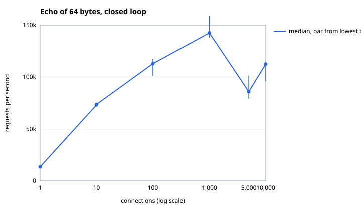

# Benchmark report: connections

Generated by `benchmarks/analyze.py` from the raw results in `runs/`.

## Where these numbers come from

| | |
| --- | --- |
| Date (UTC) | 2026-11-15T08:10:40+00:00 |
| Machine | aarch64, 8 cores, aarch64 |
| OS | Ubuntu 24.04.5 LTS (Linux 7.0.14-linuxkit) |
| Container | Yes. Linux in a virtual machine, so not what a Linux machine would give. |
| Compiler | GNU 13.3.0 |
| Build | Release, flags `-O3 -DNDEBUG`, sanitizer none |
| Commit | dafec023e3f9a80b495aa37a27803d6085a9c4ee |
| Server waits with | epoll |
| Client waits with | epoll |
| Each cell | 5 runs of 5 s after 2 s of warm-up, fresh server each run |
| Client threads | 1, 4 |
| CPU pinning | server: 0-3, client: 4-7 |
| Command | `benchmarks/run.py --build /build --suite connections --poller epoll --server-cpus 0-3 --client-cpus 4-7` |

## Results

Throughput is the median over the runs, with the lowest and highest run
beside it. Latencies are the median over the runs of each run's
percentile. A percentile is left out when a run had too few samples for it.

| Cell | Requests/s | Lowest to highest | p50 | p99 | p99.9 | Worst | MiB/s | Not answered |
| --- | ---: | --- | ---: | ---: | ---: | ---: | ---: | ---: |
| echo-64B-1c | 13,537 | 13,277 to 13,837 | 72 µs | 110 µs | 264 µs | 18.00 ms | 2.0 | 0 |
| echo-64B-10c | 73,401 | 72,288 to 73,908 | 131 µs | 270 µs | 365 µs | 55.14 ms | 10.6 | 0 |
| echo-64B-100c | 112,807 | 100,932 to 117,412 | 831 µs | 1.74 ms | 2.44 ms | 40.76 ms | 16.4 | 0 |
| echo-64B-1000c | 142,479 | 137,882 to 158,873 | 6.88 ms | 9.18 ms | 11.80 ms | 19.00 ms | 20.7 | 0 |
| echo-64B-5000c | 85,693 | 78,984 to 101,192 | 58.72 ms | 61.34 ms | 61.87 ms | 88.35 ms | 12.4 | 0 |
| echo-64B-10000c | 112,420 | 95,826 to 114,796 | 87.03 ms | 149.95 ms | 151.70 ms | 213.08 ms | 16.3 | 4,369 |

Latency in a closed loop is counted from when a request was sent. In an
open loop it is counted from when the request was due, so it includes any
time the request waited to be sent.

## The server while it was measured

| Cell | CPU (cores) | Workers busy | Memory | Deepest queue | Switches/s forced | Switches/s by choice |
| --- | ---: | ---: | ---: | ---: | ---: | ---: |
| echo-64B-1c | 0.48 | 1% | 3 MiB | 1 | 0 | 40,367 |
| echo-64B-10c | 1.08 | 2% | 3 MiB | 7 | 50 | 70,851 |
| echo-64B-100c | 1.14 | 1% | 3 MiB | 17 | 49 | 65,867 |
| echo-64B-1000c | 1.14 | 2% | 4 MiB | 27 | 156 | 38,954 |
| echo-64B-5000c | 1.12 | 2% | 6 MiB | 29 | 31 | 49,088 |
| echo-64B-10000c | 1.11 | 2% | 9 MiB | 31 | 115 | 33,867 |

CPU is in cores: 1.00 is one core used all the time. Context switches
are only available on Linux.

## Was the client the limit?

No run was flagged. In a closed loop a run is flagged when the client's
threads use 85% or more of their time. In an open loop it is flagged
when more than 1% of requests were sent over a millisecond late.

| Cell | Client threads | Client CPU per thread |
| --- | ---: | ---: |
| echo-64B-1c | 1 | 0.19 |
| echo-64B-10c | 4 | 0.15 |
| echo-64B-100c | 4 | 0.17 |
| echo-64B-1000c | 4 | 0.23 |
| echo-64B-5000c | 4 | 0.15 |
| echo-64B-10000c | 4 | 0.21 |

## Plots

