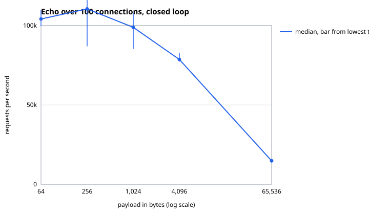

# Benchmark report: payloads

Generated by `benchmarks/analyze.py` from the raw results in `runs/`.

## Where these numbers come from

| | |
| --- | --- |
| Date (UTC) | 2026-11-15T08:14:15+00:00 |
| Machine | aarch64, 8 cores, aarch64 |
| OS | Ubuntu 24.04.5 LTS (Linux 7.0.14-linuxkit) |
| Container | Yes. Linux in a virtual machine, so not what a Linux machine would give. |
| Compiler | GNU 13.3.0 |
| Build | Release, flags `-O3 -DNDEBUG`, sanitizer none |
| Commit | dafec023e3f9a80b495aa37a27803d6085a9c4ee |
| Server waits with | epoll |
| Client waits with | epoll |
| Each cell | 5 runs of 5 s after 2 s of warm-up, fresh server each run |
| Client threads | 4 |
| CPU pinning | server: 0-3, client: 4-7 |
| Command | `benchmarks/run.py --build /build --suite payloads --poller epoll --server-cpus 0-3 --client-cpus 4-7` |

## Results

Throughput is the median over the runs, with the lowest and highest run
beside it. Latencies are the median over the runs of each run's
percentile. A percentile is left out when a run had too few samples for it.

| Cell | Requests/s | Lowest to highest | p50 | p99 | p99.9 | Worst | MiB/s | Not answered |
| --- | ---: | --- | ---: | ---: | ---: | ---: | ---: | ---: |
| echo-64B-100c | 104,177 | 99,598 to 109,747 | 934 µs | 1.65 ms | 2.13 ms | 28.82 ms | 15.1 | 0 |
| echo-256B-100c | 110,511 | 86,943 to 119,252 | 889 µs | 1.56 ms | 2.16 ms | 5.78 ms | 56.5 | 0 |
| echo-1024B-100c | 98,919 | 85,320 to 108,094 | 999 µs | 1.59 ms | 3.24 ms | 32.14 ms | 195.5 | 0 |
| echo-4096B-100c | 78,631 | 77,338 to 82,697 | 1.26 ms | 1.91 ms | 2.36 ms | 11.67 ms | 616.1 | 0 |
| echo-65536B-100c | 14,774 | 14,334 to 15,022 | 6.72 ms | 9.76 ms | 10.94 ms | 16.13 ms | 1847.0 | 0 |

Latency in a closed loop is counted from when a request was sent. In an
open loop it is counted from when the request was due, so it includes any
time the request waited to be sent.

## The server while it was measured

| Cell | CPU (cores) | Workers busy | Memory | Deepest queue | Switches/s forced | Switches/s by choice |
| --- | ---: | ---: | ---: | ---: | ---: | ---: |
| echo-64B-100c | 1.14 | 1% | 3 MiB | 27 | 50 | 64,882 |
| echo-256B-100c | 1.17 | 2% | 3 MiB | 14 | 96 | 64,227 |
| echo-1024B-100c | 1.17 | 2% | 4 MiB | 14 | 96 | 61,592 |
| echo-4096B-100c | 1.19 | 3% | 5 MiB | 8 | 82 | 54,793 |
| echo-65536B-100c | 1.34 | 7% | 23 MiB | 2 | 1 | 15,490 |

CPU is in cores: 1.00 is one core used all the time. Context switches
are only available on Linux.

## Was the client the limit?

No run was flagged. In a closed loop a run is flagged when the client's
threads use 85% or more of their time. In an open loop it is flagged
when more than 1% of requests were sent over a millisecond late.

| Cell | Client threads | Client CPU per thread |
| --- | ---: | ---: |
| echo-64B-100c | 4 | 0.17 |
| echo-256B-100c | 4 | 0.17 |
| echo-1024B-100c | 4 | 0.15 |
| echo-4096B-100c | 4 | 0.13 |
| echo-65536B-100c | 4 | 0.12 |

## Plots

