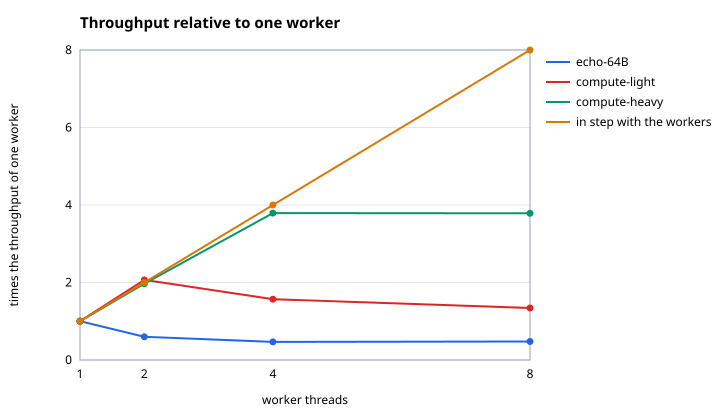

# Benchmark report: workers

Generated by `benchmarks/analyze.py` from the raw results in `runs/`.

## Where these numbers come from

| | |
| --- | --- |
| Date (UTC) | 2026-11-15T08:20:49+00:00 |
| Machine | aarch64, 8 cores, aarch64 |
| OS | Ubuntu 24.04.5 LTS (Linux 7.0.14-linuxkit) |
| Container | Yes. Linux in a virtual machine, so not what a Linux machine would give. |
| Compiler | GNU 13.3.0 |
| Build | Release, flags `-O3 -DNDEBUG`, sanitizer none |
| Commit | dafec023e3f9a80b495aa37a27803d6085a9c4ee |
| Server waits with | epoll |
| Client waits with | epoll |
| Each cell | 5 runs of 5 s after 2 s of warm-up, fresh server each run |
| Client threads | 4 |
| CPU pinning | server: 0-3, client: 4-7 |
| Command | `benchmarks/run.py --build /build --suite workers --poller epoll --server-cpus 0-3 --client-cpus 4-7` |

## Results

Throughput is the median over the runs, with the lowest and highest run
beside it. Latencies are the median over the runs of each run's
percentile. A percentile is left out when a run had too few samples for it.

| Cell | Requests/s | Lowest to highest | p50 | p99 | p99.9 | Worst | MiB/s | Not answered |
| --- | ---: | --- | ---: | ---: | ---: | ---: | ---: | ---: |
| echo-64B-1w | 213,639 | 208,345 to 216,267 | 449 µs | 807 µs | 954 µs | 1.62 ms | 31.0 | 0 |
| echo-64B-2w | 128,064 | 115,174 to 143,662 | 762 µs | 1.34 ms | 1.68 ms | 2.86 ms | 18.6 | 0 |
| echo-64B-4w | 99,541 | 97,722 to 100,032 | 987 µs | 1.69 ms | 2.15 ms | 4.10 ms | 14.4 | 0 |
| echo-64B-8w | 102,193 | 99,139 to 106,230 | 967 µs | 1.57 ms | 2.02 ms | 2.79 ms | 14.8 | 0 |
| compute-light-1w | 103,264 | 103,056 to 103,358 | 971 µs | 1.07 ms | 1.16 ms | 1.78 ms | 9.8 | 0 |
| compute-light-2w | 213,497 | 210,565 to 216,983 | 451 µs | 827 µs | 950 µs | 1.36 ms | 20.4 | 0 |
| compute-light-4w | 161,972 | 159,134 to 162,861 | 578 µs | 1.28 ms | 1.53 ms | 6.58 ms | 15.4 | 0 |
| compute-light-8w | 138,541 | 136,682 to 140,682 | 684 µs | 1.52 ms | 1.81 ms | 2.75 ms | 13.2 | 0 |
| compute-heavy-1w | 76 | 76 to 76 | 1.31 s | n/a | n/a | 1.32 s | 0.1 | 0 |
| compute-heavy-2w | 150 | 150 to 150 | 666.89 ms | n/a | n/a | 672.39 ms | 0.2 | 0 |
| compute-heavy-4w | 289 | 288 to 290 | 346.03 ms | 349.91 ms | n/a | 351.83 ms | 0.3 | 0 |
| compute-heavy-8w | 289 | 288 to 289 | 348.13 ms | 373.29 ms | n/a | 376.06 ms | 0.3 | 0 |

Latency in a closed loop is counted from when a request was sent. In an
open loop it is counted from when the request was due, so it includes any
time the request waited to be sent.

## The server while it was measured

| Cell | CPU (cores) | Workers busy | Memory | Deepest queue | Switches/s forced | Switches/s by choice |
| --- | ---: | ---: | ---: | ---: | ---: | ---: |
| echo-64B-1w | 1.19 | 6% | 3 MiB | 29 | 3 | 23,323 |
| echo-64B-2w | 1.12 | 3% | 3 MiB | 18 | 3 | 44,662 |
| echo-64B-4w | 1.14 | 1% | 3 MiB | 22 | 48 | 66,268 |
| echo-64B-8w | 1.20 | 1% | 3 MiB | 21 | 703 | 88,725 |
| compute-light-1w | 1.72 | 99% | 3 MiB | 98 | 3 | 17,762 |
| compute-light-2w | 2.94 | 96% | 3 MiB | 93 | 3 | 2,166 |
| compute-light-4w | 2.66 | 39% | 3 MiB | 48 | 85 | 34,154 |
| compute-light-8w | 2.42 | 17% | 3 MiB | 45 | 1,078 | 61,038 |
| compute-heavy-1w | 1.00 | 100% | 3 MiB | 99 | 5 | 156 |
| compute-heavy-2w | 2.00 | 100% | 3 MiB | 98 | 5 | 303 |
| compute-heavy-4w | 4.00 | 100% | 4 MiB | 96 | 470 | 465 |
| compute-heavy-8w | 4.00 | 100% | 4 MiB | 93 | 1,451 | 446 |

CPU is in cores: 1.00 is one core used all the time. Context switches
are only available on Linux.

## Was the client the limit?

No run was flagged. In a closed loop a run is flagged when the client's
threads use 85% or more of their time. In an open loop it is flagged
when more than 1% of requests were sent over a millisecond late.

| Cell | Client threads | Client CPU per thread |
| --- | ---: | ---: |
| echo-64B-1w | 4 | 0.28 |
| echo-64B-2w | 4 | 0.20 |
| echo-64B-4w | 4 | 0.16 |
| echo-64B-8w | 4 | 0.18 |
| compute-light-1w | 4 | 0.16 |
| compute-light-2w | 4 | 0.37 |
| compute-light-4w | 4 | 0.31 |
| compute-light-8w | 4 | 0.27 |
| compute-heavy-1w | 4 | 0.00 |
| compute-heavy-2w | 4 | 0.00 |
| compute-heavy-4w | 4 | 0.00 |
| compute-heavy-8w | 4 | 0.00 |

## Plots

