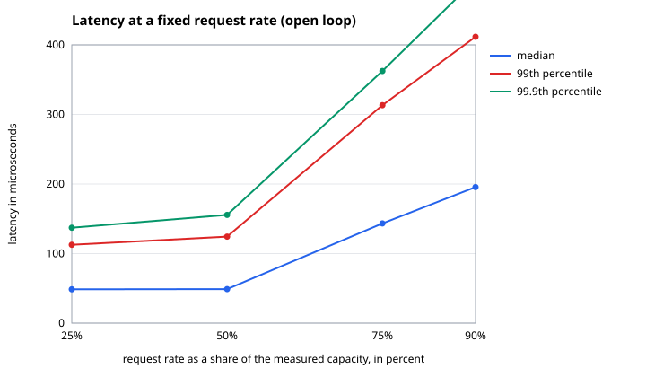

# Benchmark report: latency

Generated by `benchmarks/analyze.py` from the raw results in `runs/`.

## Where these numbers come from

| | |
| --- | --- |
| Date (UTC) | 2026-11-15T08:27:57+00:00 |
| Machine | aarch64, 8 cores, aarch64 |
| OS | Ubuntu 24.04.5 LTS (Linux 7.0.14-linuxkit) |
| Container | Yes. Linux in a virtual machine, so not what a Linux machine would give. |
| Compiler | GNU 13.3.0 |
| Build | Release, flags `-O3 -DNDEBUG`, sanitizer none |
| Commit | dafec023e3f9a80b495aa37a27803d6085a9c4ee |
| Server waits with | epoll |
| Client waits with | epoll |
| Each cell | 5 runs of 5 s after 2 s of warm-up, fresh server each run |
| Client threads | 2 |
| CPU pinning | server: 0-3, client: 4-7 |
| Command | `benchmarks/run.py --build /build --suite latency --poller epoll --server-cpus 0-3 --client-cpus 4-7` |

## Results

Throughput is the median over the runs, with the lowest and highest run
beside it. Latencies are the median over the runs of each run's
percentile. A percentile is left out when a run had too few samples for it.

| Cell | Requests/s | Lowest to highest | p50 | p99 | p99.9 | Worst | MiB/s | Not answered |
| --- | ---: | --- | ---: | ---: | ---: | ---: | ---: | ---: |
| echo-64B-100c-capacity | 92,577 | 89,928 to 97,793 | 1.06 ms | 1.78 ms | 2.26 ms | 4.74 ms | 13.4 | 0 |
| echo-64B-100c-25pct | 23,150 | 23,145 to 23,169 | 49 µs | 113 µs | 137 µs | 481 µs | 3.4 | 0 |
| echo-64B-100c-50pct | 46,290 | 46,208 to 46,374 | 49 µs | 124 µs | 156 µs | 2.49 ms | 6.7 | 0 |
| echo-64B-100c-75pct | 69,438 | 69,406 to 69,446 | 143 µs | 313 µs | 362 µs | 1.38 ms | 10.1 | 0 |
| echo-64B-100c-90pct | 83,325 | 83,317 to 83,413 | 196 µs | 412 µs | 494 µs | 16.50 ms | 12.1 | 0 |

Latency in a closed loop is counted from when a request was sent. In an
open loop it is counted from when the request was due, so it includes any
time the request waited to be sent.

Open-loop cells and the rate they asked for:

- echo-64B-100c-90pct: asked for 83,319 per second, 0 requests were due and never sent.
- echo-64B-100c-50pct: asked for 46,288 per second, 0 requests were due and never sent.
- echo-64B-100c-75pct: asked for 69,433 per second, 0 requests were due and never sent.
- echo-64B-100c-25pct: asked for 23,144 per second, 0 requests were due and never sent.

## The server while it was measured

| Cell | CPU (cores) | Workers busy | Memory | Deepest queue | Switches/s forced | Switches/s by choice |
| --- | ---: | ---: | ---: | ---: | ---: | ---: |
| echo-64B-100c-capacity | 1.11 | 1% | 3 MiB | 15 | 31 | 70,990 |
| echo-64B-100c-25pct | 0.61 | 2% | 3 MiB | 2 | 0 | 49,442 |
| echo-64B-100c-50pct | 0.94 | 2% | 3 MiB | 3 | 1 | 70,794 |
| echo-64B-100c-75pct | 1.05 | 1% | 3 MiB | 10 | 9 | 77,997 |
| echo-64B-100c-90pct | 1.06 | 1% | 3 MiB | 27 | 10 | 75,130 |

CPU is in cores: 1.00 is one core used all the time. Context switches
are only available on Linux.

## Was the client the limit?

No run was flagged. In a closed loop a run is flagged when the client's
threads use 85% or more of their time. In an open loop it is flagged
when more than 1% of requests were sent over a millisecond late.

| Cell | Client threads | Client CPU per thread |
| --- | ---: | ---: |
| echo-64B-100c-capacity | 2 | 0.24 |
| echo-64B-100c-25pct | 2 | 1.00 |
| echo-64B-100c-50pct | 2 | 1.00 |
| echo-64B-100c-75pct | 2 | 1.00 |
| echo-64B-100c-90pct | 2 | 1.00 |

## Plots

