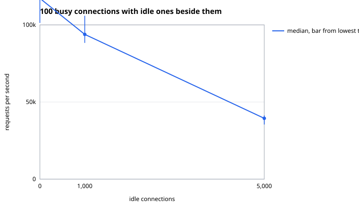

# Benchmark report: mix

Generated by `benchmarks/analyze.py` from the raw results in `runs/`.

## Where these numbers come from

| | |
| --- | --- |
| Date (UTC) | 2026-11-15T08:37:46+00:00 |
| Machine | aarch64, 8 cores, aarch64 |
| OS | Ubuntu 24.04.5 LTS (Linux 7.0.14-linuxkit) |
| Container | Yes. Linux in a virtual machine, so not what a Linux machine would give. |
| Compiler | GNU 13.3.0 |
| Build | Release, flags `-O3 -DNDEBUG`, sanitizer none |
| Commit | dafec023e3f9a80b495aa37a27803d6085a9c4ee |
| Server waits with | poll |
| Client waits with | epoll |
| Each cell | 5 runs of 5 s after 2 s of warm-up, fresh server each run |
| Client threads | 4 |
| CPU pinning | server: 0-3, client: 4-7 |
| Command | `benchmarks/run.py --build /build --suite mix --poller poll --server-cpus 0-3 --client-cpus 4-7` |

## Results

Throughput is the median over the runs, with the lowest and highest run
beside it. Latencies are the median over the runs of each run's
percentile. A percentile is left out when a run had too few samples for it.

| Cell | Requests/s | Lowest to highest | p50 | p99 | p99.9 | Worst | MiB/s | Not answered |
| --- | ---: | --- | ---: | ---: | ---: | ---: | ---: | ---: |
| echo-64B-100c-0idle | 117,207 | 101,243 to 126,100 | 811 µs | 1.68 ms | 2.13 ms | 4.47 ms | 17.0 | 0 |
| echo-64B-100c-1000idle | 93,854 | 88,316 to 105,906 | 1.03 ms | 1.97 ms | 2.42 ms | 3.67 ms | 13.6 | 0 |
| echo-64B-100c-5000idle | 39,424 | 35,408 to 41,269 | 2.38 ms | 4.62 ms | 5.11 ms | 27.05 ms | 5.7 | 0 |

Latency in a closed loop is counted from when a request was sent. In an
open loop it is counted from when the request was due, so it includes any
time the request waited to be sent.

## The server while it was measured

| Cell | CPU (cores) | Workers busy | Memory | Deepest queue | Switches/s forced | Switches/s by choice |
| --- | ---: | ---: | ---: | ---: | ---: | ---: |
| echo-64B-100c-0idle | 1.15 | 2% | 3 MiB | 17 | 50 | 66,945 |
| echo-64B-100c-1000idle | 1.12 | 1% | 4 MiB | 0 | 33 | 54,549 |
| echo-64B-100c-5000idle | 1.05 | 0% | 5 MiB | 0 | 12 | 25,405 |

CPU is in cores: 1.00 is one core used all the time. Context switches
are only available on Linux.

## Was the client the limit?

No run was flagged. In a closed loop a run is flagged when the client's
threads use 85% or more of their time. In an open loop it is flagged
when more than 1% of requests were sent over a millisecond late.

| Cell | Client threads | Client CPU per thread |
| --- | ---: | ---: |
| echo-64B-100c-0idle | 4 | 0.17 |
| echo-64B-100c-1000idle | 4 | 0.13 |
| echo-64B-100c-5000idle | 4 | 0.07 |

## Plots

