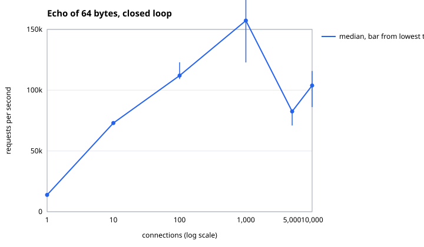

# Benchmark report: connections

Generated by `benchmarks/analyze.py` from the raw results in `runs/`.

## Where these numbers come from

| | |
| --- | --- |
| Date (UTC) | 2026-11-15T08:39:34+00:00 |
| Machine | aarch64, 8 cores, aarch64 |
| OS | Ubuntu 24.04.5 LTS (Linux 7.0.14-linuxkit) |
| Container | Yes. Linux in a virtual machine, so not what a Linux machine would give. |
| Compiler | GNU 13.3.0 |
| Build | Release, flags `-O3 -DNDEBUG`, sanitizer none |
| Commit | dafec023e3f9a80b495aa37a27803d6085a9c4ee |
| Server waits with | poll |
| Client waits with | epoll |
| Each cell | 5 runs of 5 s after 2 s of warm-up, fresh server each run |
| Client threads | 1, 4 |
| CPU pinning | server: 0-3, client: 4-7 |
| Command | `benchmarks/run.py --build /build --suite connections --poller poll --server-cpus 0-3 --client-cpus 4-7` |

## Results

Throughput is the median over the runs, with the lowest and highest run
beside it. Latencies are the median over the runs of each run's
percentile. A percentile is left out when a run had too few samples for it.

| Cell | Requests/s | Lowest to highest | p50 | p99 | p99.9 | Worst | MiB/s | Not answered |
| --- | ---: | --- | ---: | ---: | ---: | ---: | ---: | ---: |
| echo-64B-1c | 13,856 | 13,713 to 13,989 | 72 µs | 87 µs | 102 µs | 787 µs | 2.0 | 0 |
| echo-64B-10c | 72,977 | 71,903 to 74,396 | 133 µs | 268 µs | 322 µs | 6.74 ms | 10.6 | 0 |
| echo-64B-100c | 112,007 | 109,170 to 122,924 | 856 µs | 1.70 ms | 1.98 ms | 4.35 ms | 16.2 | 0 |
| echo-64B-1000c | 157,277 | 122,794 to 175,564 | 6.32 ms | 12.06 ms | 13.83 ms | 24.68 ms | 22.8 | 0 |
| echo-64B-5000c | 82,493 | 70,949 to 83,772 | 59.51 ms | 136.31 ms | 146.80 ms | 196.84 ms | 12.0 | 971 |
| echo-64B-10000c | 103,833 | 86,077 to 115,804 | 90.18 ms | 175.11 ms | 176.16 ms | 263.08 ms | 15.1 | 2,133 |

Latency in a closed loop is counted from when a request was sent. In an
open loop it is counted from when the request was due, so it includes any
time the request waited to be sent.

## The server while it was measured

| Cell | CPU (cores) | Workers busy | Memory | Deepest queue | Switches/s forced | Switches/s by choice |
| --- | ---: | ---: | ---: | ---: | ---: | ---: |
| echo-64B-1c | 0.49 | 1% | 3 MiB | 1 | 0 | 41,569 |
| echo-64B-10c | 1.08 | 2% | 3 MiB | 10 | 41 | 71,642 |
| echo-64B-100c | 1.15 | 1% | 3 MiB | 17 | 57 | 66,226 |
| echo-64B-1000c | 1.15 | 2% | 4 MiB | 0 | 117 | 48,473 |
| echo-64B-5000c | 1.12 | 2% | 6 MiB | 0 | 25 | 58,595 |
| echo-64B-10000c | 1.11 | 2% | 9 MiB | 0 | 73 | 48,126 |

CPU is in cores: 1.00 is one core used all the time. Context switches
are only available on Linux.

## Was the client the limit?

No run was flagged. In a closed loop a run is flagged when the client's
threads use 85% or more of their time. In an open loop it is flagged
when more than 1% of requests were sent over a millisecond late.

| Cell | Client threads | Client CPU per thread |
| --- | ---: | ---: |
| echo-64B-1c | 1 | 0.19 |
| echo-64B-10c | 4 | 0.15 |
| echo-64B-100c | 4 | 0.18 |
| echo-64B-1000c | 4 | 0.21 |
| echo-64B-5000c | 4 | 0.13 |
| echo-64B-10000c | 4 | 0.17 |

## Plots

