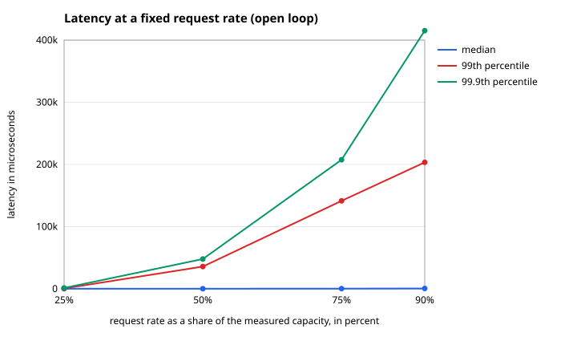

# Benchmark report: latency

Generated by `benchmarks/analyze.py` from the raw results in `runs/`.

## Where these numbers come from

| | |
| --- | --- |
| Date (UTC) | 2026-11-15T08:43:10+00:00 |
| Machine | Apple M1, 8 cores, arm64 |
| OS | macOS 26.6.2 (Darwin 25.6.0) |
| Power | AC Power |
| Compiler | AppleClang 17.0.0.17000013 |
| Build | Release, flags `-O3 -DNDEBUG`, sanitizer none |
| Commit | dafec023e3f9a80b495aa37a27803d6085a9c4ee plus uncommitted changes |
| Server waits with | poll |
| Client waits with | poll |
| Each cell | 5 runs of 5 s after 2 s of warm-up, fresh server each run |
| Client threads | 2 |
| CPU pinning | server: not pinned, client: not pinned |
| Command | `benchmarks/run.py --build build-release --suite latency` |

## Results

Throughput is the median over the runs, with the lowest and highest run
beside it. Latencies are the median over the runs of each run's
percentile. A percentile is left out when a run had too few samples for it.

| Cell | Requests/s | Lowest to highest | p50 | p99 | p99.9 | Worst | MiB/s | Not answered |
| --- | ---: | --- | ---: | ---: | ---: | ---: | ---: | ---: |
| echo-64B-100c-capacity | 129,721 | 108,223 to 132,953 | 721 µs | 1.46 ms | 3.46 ms | 112.58 ms | 18.8 | 0 |
| echo-64B-100c-25pct | 32,399 | 32,397 to 32,409 | 216 µs | 643 µs | 1.39 ms | 4.91 ms | 4.7 | 0 |
| echo-64B-100c-50pct | 64,803 | 64,797 to 64,884 | 248 µs | 35.91 ms | 47.97 ms | 269.77 ms | 9.4 | 0 |
| echo-64B-100c-75pct | 97,268 | 94,995 to 98,172 | 356 µs | 141.56 ms | 207.62 ms | 1.07 s | 14.1 | 0 |
| echo-64B-100c-90pct | 116,658 | 114,791 to 116,756 | 602 µs | 203.42 ms | 415.24 ms | 675.51 ms | 16.9 | 0 |

Latency in a closed loop is counted from when a request was sent. In an
open loop it is counted from when the request was due, so it includes any
time the request waited to be sent.

Open-loop cells and the rate they asked for:

- echo-64B-100c-90pct: asked for 116,749 per second, 11,027 requests were due and never sent.
- echo-64B-100c-50pct: asked for 64,860 per second, 0 requests were due and never sent.
- echo-64B-100c-75pct: asked for 97,291 per second, 25,134 requests were due and never sent.
- echo-64B-100c-25pct: asked for 32,430 per second, 0 requests were due and never sent.

## The server while it was measured

| Cell | CPU (cores) | Workers busy | Memory | Deepest queue | Switches/s forced | Switches/s by choice |
| --- | ---: | ---: | ---: | ---: | ---: | ---: |
| echo-64B-100c-capacity | 1.59 | 3% | 1 MiB | 18 | n/a | n/a |
| echo-64B-100c-25pct | 1.13 | 1% | 2 MiB | 0 | n/a | n/a |
| echo-64B-100c-50pct | 1.25 | 2% | 2 MiB | 47 | n/a | n/a |
| echo-64B-100c-75pct | 1.39 | 2% | 2 MiB | 0 | n/a | n/a |
| echo-64B-100c-90pct | 1.51 | 3% | 2 MiB | 0 | n/a | n/a |

CPU is in cores: 1.00 is one core used all the time. Context switches
are only available on Linux.

## Was the client the limit?

**Yes, in these cells.** Their numbers say what the client could do,
not what the server could do:

- echo-64B-100c-90pct: 1 of 5 runs, client CPU per thread 0.91.
- echo-64B-100c-50pct: 3 of 5 runs, client CPU per thread 0.90.
- echo-64B-100c-75pct: 2 of 5 runs, client CPU per thread 0.89.

| Cell | Client threads | Client CPU per thread |
| --- | ---: | ---: |
| echo-64B-100c-capacity | 2 | 0.76 |
| echo-64B-100c-25pct | 2 | 0.91 |
| echo-64B-100c-50pct | 2 | 0.90 |
| echo-64B-100c-75pct | 2 | 0.89 |
| echo-64B-100c-90pct | 2 | 0.91 |

## Plots

