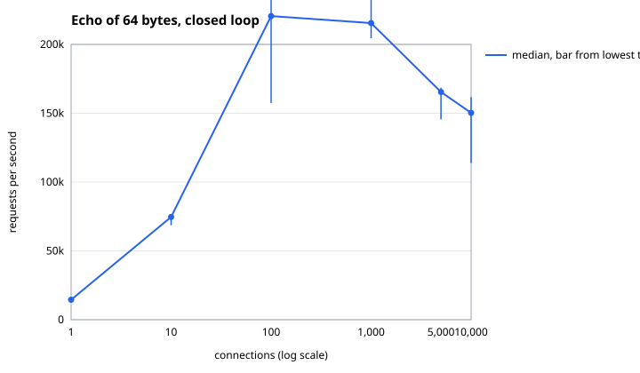

# Benchmark report: connections

Generated by `benchmarks/analyze.py` from the raw results in `runs/`.

## Where these numbers come from

| | |
| --- | --- |
| Date (UTC) | 2026-11-15T10:29:33+00:00 |
| Machine | aarch64, 8 cores, aarch64 |
| OS | Ubuntu 24.04.5 LTS (Linux 7.0.14-linuxkit) |
| Container | Yes. Linux in a virtual machine, so not what a Linux machine would give. |
| Compiler | GNU 13.3.0 |
| Build | Release, flags `-O3 -DNDEBUG`, sanitizer none |
| Commit | 56eeaafb928cb0d97e6584da141a2af78a281491 |
| Server waits with | epoll |
| Client waits with | epoll |
| Each cell | 5 runs of 5 s after 2 s of warm-up, fresh server each run |
| Client threads | 1, 4 |
| CPU pinning | server: 0-3, client: 4-7 |
| Command | `benchmarks/run.py --build /build-release --suite connections --server-cpus 0-3 --client-cpus 4-7` |

## Results

Throughput is the median over the runs, with the lowest and highest run
beside it. Latencies are the median over the runs of each run's
percentile. A percentile is left out when a run had too few samples for it.

| Cell | Requests/s | Lowest to highest | p50 | p99 | p99.9 | Worst | MiB/s | Not answered |
| --- | ---: | --- | ---: | ---: | ---: | ---: | ---: | ---: |
| echo-64B-1c | 14,548 | 14,263 to 14,634 | 69 µs | 83 µs | 103 µs | 10.44 ms | 2.1 | 0 |
| echo-64B-10c | 74,643 | 68,611 to 76,157 | 129 µs | 243 µs | 365 µs | 12.28 ms | 10.8 | 0 |
| echo-64B-100c | 220,608 | 157,336 to 246,195 | 406 µs | 1.18 ms | 2.10 ms | 49.67 ms | 32.0 | 0 |
| echo-64B-1000c | 215,500 | 204,492 to 236,203 | 4.42 ms | 11.01 ms | 13.43 ms | 30.42 ms | 31.2 | 0 |
| echo-64B-5000c | 165,425 | 145,557 to 168,572 | 29.75 ms | 44.04 ms | 53.48 ms | 62.18 ms | 24.0 | 0 |
| echo-64B-10000c | 150,263 | 113,883 to 161,645 | 62.13 ms | 122.68 ms | 129.95 ms | 271.81 ms | 21.8 | 290 |

Latency in a closed loop is counted from when a request was sent. In an
open loop it is counted from when the request was due, so it includes any
time the request waited to be sent.

## The server while it was measured

| Cell | CPU (cores) | Workers busy | Memory | Deepest queue | Switches/s forced | Switches/s by choice |
| --- | ---: | ---: | ---: | ---: | ---: | ---: |
| echo-64B-1c | 0.47 | 2% | 3 MiB | 1 | 0 | 43,531 |
| echo-64B-10c | 1.02 | 2% | 3 MiB | 9 | 22 | 71,938 |
| echo-64B-100c | 1.22 | 2% | 3 MiB | 80 | 310 | 51,771 |
| echo-64B-1000c | 1.18 | 3% | 4 MiB | 67 | 442 | 40,509 |
| echo-64B-5000c | 1.15 | 2% | 6 MiB | 57 | 256 | 37,795 |
| echo-64B-10000c | 1.14 | 3% | 8 MiB | 47 | 272 | 40,768 |

CPU is in cores: 1.00 is one core used all the time. Context switches
are only available on Linux.

## Was the client the limit?

No run was flagged. In a closed loop a run is flagged when the client's
threads use 85% or more of their time. In an open loop it is flagged
when more than 1% of requests were sent over a millisecond late.

| Cell | Client threads | Client CPU per thread |
| --- | ---: | ---: |
| echo-64B-1c | 1 | 0.20 |
| echo-64B-10c | 4 | 0.17 |
| echo-64B-100c | 4 | 0.24 |
| echo-64B-1000c | 4 | 0.25 |
| echo-64B-5000c | 4 | 0.25 |
| echo-64B-10000c | 4 | 0.24 |

## Plots

