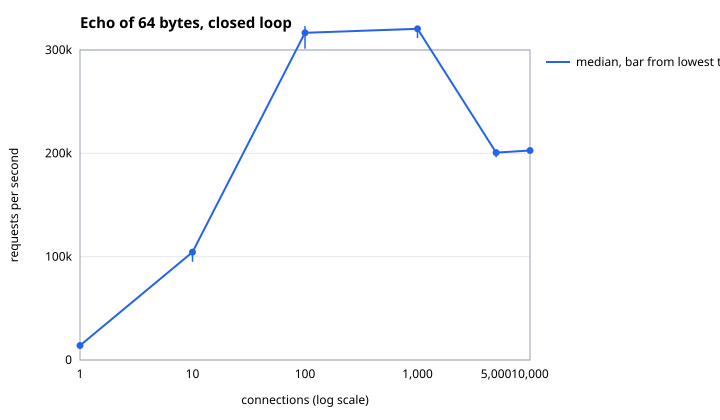

# Benchmark report: connections

Generated by `benchmarks/analyze.py` from the raw results in `runs/`.

## Where these numbers come from

| | |
| --- | --- |
| Date (UTC) | 2026-11-15T10:33:19+00:00 |
| Machine | aarch64, 8 cores, aarch64 |
| OS | Ubuntu 24.04.5 LTS (Linux 7.0.14-linuxkit) |
| Container | Yes. Linux in a virtual machine, so not what a Linux machine would give. |
| Compiler | GNU 13.3.0 |
| Build | Release, flags `-O3 -DNDEBUG`, sanitizer none |
| Commit | fe5ac43da8fd5ef9428d4eec38109d9cf6a25db2 |
| Server waits with | epoll |
| Client waits with | epoll |
| Each cell | 5 runs of 5 s after 2 s of warm-up, fresh server each run |
| Client threads | 1, 4 |
| CPU pinning | server: 0-3, client: 4-7 |
| Command | `benchmarks/run.py --build /build-release --suite connections --server-cpus 0-3 --client-cpus 4-7` |

## Results

Throughput is the median over the runs, with the lowest and highest run
beside it. Latencies are the median over the runs of each run's
percentile. A percentile is left out when a run had too few samples for it.

| Cell | Requests/s | Lowest to highest | p50 | p99 | p99.9 | Worst | MiB/s | Not answered |
| --- | ---: | --- | ---: | ---: | ---: | ---: | ---: | ---: |
| echo-64B-1c | 14,030 | 13,696 to 14,371 | 70 µs | 172 µs | 438 µs | 9.38 ms | 2.0 | 0 |
| echo-64B-10c | 104,379 | 94,986 to 105,828 | 93 µs | 173 µs | 236 µs | 21.42 ms | 15.1 | 0 |
| echo-64B-100c | 316,655 | 301,294 to 323,110 | 307 µs | 532 µs | 1.41 ms | 53.16 ms | 45.9 | 0 |
| echo-64B-1000c | 320,555 | 311,481 to 323,059 | 3.23 ms | 4.52 ms | 6.03 ms | 19.76 ms | 46.5 | 0 |
| echo-64B-5000c | 200,719 | 196,179 to 203,418 | 24.90 ms | 27.79 ms | 30.28 ms | 52.51 ms | 29.1 | 103 |
| echo-64B-10000c | 202,701 | 201,097 to 204,869 | 49.28 ms | 54.00 ms | 57.41 ms | 69.82 ms | 29.4 | 0 |

Latency in a closed loop is counted from when a request was sent. In an
open loop it is counted from when the request was due, so it includes any
time the request waited to be sent.

## The server while it was measured

| Cell | CPU (cores) | Workers busy | Memory | Deepest queue | Switches/s forced | Switches/s by choice |
| --- | ---: | ---: | ---: | ---: | ---: | ---: |
| echo-64B-1c | 0.47 | 2% | 3 MiB | 1 | 0 | 42,015 |
| echo-64B-10c | 1.02 | 2% | 3 MiB | 10 | 27 | 63,876 |
| echo-64B-100c | 1.22 | 3% | 3 MiB | 100 | 343 | 21,248 |
| echo-64B-1000c | 1.21 | 5% | 4 MiB | 979 | 1,032 | 9,788 |
| echo-64B-5000c | 1.13 | 4% | 6 MiB | 905 | 382 | 4,406 |
| echo-64B-10000c | 1.14 | 4% | 9 MiB | 785 | 500 | 5,188 |

CPU is in cores: 1.00 is one core used all the time. Context switches
are only available on Linux.

## Was the client the limit?

No run was flagged. In a closed loop a run is flagged when the client's
threads use 85% or more of their time. In an open loop it is flagged
when more than 1% of requests were sent over a millisecond late.

| Cell | Client threads | Client CPU per thread |
| --- | ---: | ---: |
| echo-64B-1c | 1 | 0.20 |
| echo-64B-10c | 4 | 0.19 |
| echo-64B-100c | 4 | 0.31 |
| echo-64B-1000c | 4 | 0.31 |
| echo-64B-5000c | 4 | 0.32 |
| echo-64B-10000c | 4 | 0.32 |

## Plots

