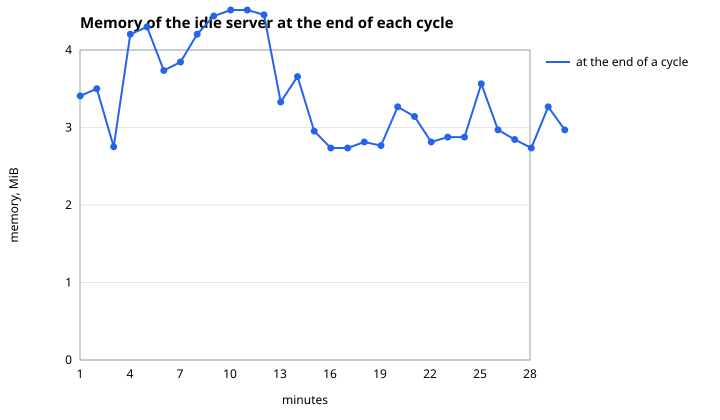

# Soak test

**FAILED.** 30.1 minutes in 30 cycles of 60 s, the first 3 left out as warm-up.

| Check | Result | |
| --- | --- | --- |
| descriptors at the end of every cycle are what they were at the start | pass | 7 throughout |
| memory at the end of the cycles does not grow | pass | first third 4.30 MiB, last third 2.88 MiB, fitted growth over the run -1.58 MiB, allowed 2.0 MiB |
| no well-behaved request failed | **fail** | echo idle_lost: 6000 |
| no request failed inside a worker | pass | 0 |
| the server stops with exit code 0 when asked | pass | exit code 0 |

## Where this was run

| | |
| --- | --- |
| Date (UTC) | 2026-11-15T20:12:57+00:00 |
| Machine | Apple M1, 8 cores, arm64 |
| OS | macOS 26.6.2 (Darwin 25.6.0) |
| Power | AC Power |
| Compiler | AppleClang 17.0.0.17000013 |
| Build | Release, flags `-O3 -DNDEBUG`, sanitizer none |
| Commit | ed7bd2287e171c30d4b5bc4bb53b2a9e2ebefb52 plus uncommitted changes |
| Server | `build-release/server --port 18091 --workers 4 --poller poll` |
| Command | `benchmarks/soak.py --build build-release --minutes 30` |

## What the server did

| Load | Requests answered |
| --- | ---: |
| echo | 44,585,490 |
| large | 14,160,831 |
| compute | 26,996,789 |
| ping | 29,538,648 |
| **all** | **115,281,758** |

By the server's own count it handed 86,316,264 requests to its workers, refused 0 for a full queue, and 0 failed in a worker. The misbehaving clients are in those numbers and not in the table.

The server wrote 30 lines to its log, which is `server.log` here. It reports timeouts and connection errors at most once a second each.

## The server at the end of each cycle

Idle, with every client gone. Peak is the most seen during the cycle.
Memory is resident memory plus what was swapped out on Linux, and the
footprint on macOS, which also counts memory the system has compressed.

| Cycle | Minute | Memory | Descriptors | Peak memory | Peak descriptors |
| ---: | ---: | ---: | ---: | ---: | ---: |
| 1 (warm-up) | 1.0 | 3.41 MiB | 7 | 3.4 MiB | 250 |
| 2 (warm-up) | 2.0 | 3.50 MiB | 7 | 4.2 MiB | 251 |
| 3 (warm-up) | 3.0 | 2.75 MiB | 7 | 4.1 MiB | 250 |
| 4 | 4.0 | 4.20 MiB | 7 | 4.2 MiB | 250 |
| 5 | 5.0 | 4.30 MiB | 7 | 4.3 MiB | 250 |
| 6 | 6.0 | 3.74 MiB | 7 | 4.3 MiB | 249 |
| 7 | 7.0 | 3.84 MiB | 7 | 3.8 MiB | 249 |
| 8 | 8.0 | 4.20 MiB | 7 | 4.4 MiB | 252 |
| 9 | 9.0 | 4.44 MiB | 7 | 4.4 MiB | 249 |
| 10 | 10.0 | 4.52 MiB | 7 | 4.5 MiB | 249 |
| 11 | 11.0 | 4.52 MiB | 7 | 4.5 MiB | 249 |
| 12 | 12.0 | 4.45 MiB | 7 | 4.5 MiB | 249 |
| 13 | 13.0 | 3.33 MiB | 7 | 4.5 MiB | 250 |
| 14 | 14.1 | 3.66 MiB | 7 | 4.3 MiB | 249 |
| 15 | 15.1 | 2.95 MiB | 7 | 4.1 MiB | 249 |
| 16 | 16.1 | 2.74 MiB | 7 | 3.4 MiB | 249 |
| 17 | 17.1 | 2.74 MiB | 7 | 3.6 MiB | 249 |
| 18 | 18.1 | 2.81 MiB | 7 | 3.3 MiB | 249 |
| 19 | 19.1 | 2.77 MiB | 7 | 3.4 MiB | 249 |
| 20 | 20.1 | 3.27 MiB | 7 | 3.7 MiB | 249 |
| 21 | 21.1 | 3.14 MiB | 7 | 3.5 MiB | 249 |
| 22 | 22.1 | 2.81 MiB | 7 | 3.2 MiB | 249 |
| 23 | 23.1 | 2.88 MiB | 7 | 3.8 MiB | 249 |
| 24 | 24.1 | 2.88 MiB | 7 | 3.4 MiB | 249 |
| 25 | 25.1 | 3.56 MiB | 7 | 3.7 MiB | 249 |
| 26 | 26.1 | 2.97 MiB | 7 | 4.2 MiB | 250 |
| 27 | 27.1 | 2.84 MiB | 7 | 3.5 MiB | 249 |
| 28 | 28.1 | 2.74 MiB | 7 | 4.2 MiB | 249 |
| 29 | 29.1 | 3.27 MiB | 7 | 4.2 MiB | 250 |
| 30 | 30.1 | 2.97 MiB | 7 | 3.4 MiB | 249 |

Before the first cycle: 0.97 MiB, 7 descriptors.
