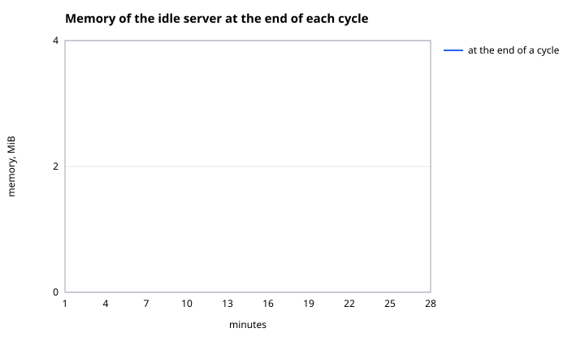

# Soak test

**Passed.** 30.1 minutes in 30 cycles of 60 s, the first 3 left out as warm-up.

| Check | Result | |
| --- | --- | --- |
| descriptors at the end of every cycle are what they were at the start | pass | 7 throughout |
| memory at the end of the cycles does not grow | pass | first third 5.04 MiB, last third 5.04 MiB, fitted growth over the run -0.03 MiB, allowed 2.0 MiB |
| no well-behaved request failed | pass | none |
| every idle connection was closed by the idle timeout, and no other | pass | 6,000 closed |
| no request failed inside a worker | pass | 0 |
| the server stops with exit code 0 when asked | pass | exit code 0 |
| the machine did not sleep during the run | pass | it did not |

## Where this was run

| | |
| --- | --- |
| Date (UTC) | 2026-11-15T20:44:52+00:00 |
| Machine | aarch64, 8 cores, aarch64 |
| OS | Ubuntu 24.04.5 LTS (Linux 7.0.14-linuxkit) |
| Container | Yes, Linux in a virtual machine. |
| Compiler | GNU 13.3.0 |
| Build | Release, flags `-O3 -DNDEBUG`, sanitizer none |
| Commit | cedb89ea7b63e5e57a8c821a2053307837f99ff4 |
| Server | `/build/server --port 18091 --workers 4 --poller epoll --idle-timeout-ms 30000` |
| Command | `benchmarks/soak.py --build /build --minutes 30` |

## What the server did

| Load | Requests answered |
| --- | ---: |
| echo | 54,365,420 |
| large | 11,210,731 |
| compute | 26,130,712 |
| ping | 26,727,665 |
| **all** | **118,434,528** |

By the server's own count it handed 92,286,244 requests to its workers, refused 0 for a full queue, and 0 failed in a worker. The misbehaving clients are in those numbers and not in the table.

The server wrote 1,810 lines to its log, which is `server.log` here. It reports timeouts and connection errors at most once a second each.

## The server at the end of each cycle

Idle, with every client gone. Peak is the most seen during the cycle.
Memory is resident memory plus what was swapped out on Linux, and the
footprint on macOS, which also counts memory the system has compressed.

| Cycle | Minute | Memory | Descriptors | Peak memory | Peak descriptors |
| ---: | ---: | ---: | ---: | ---: | ---: |
| 1 (warm-up) | 1.0 | 5.01 MiB | 7 | 5.8 MiB | 249 |
| 2 (warm-up) | 2.0 | 5.34 MiB | 7 | 5.8 MiB | 249 |
| 3 (warm-up) | 3.0 | 5.02 MiB | 7 | 5.7 MiB | 249 |
| 4 | 4.0 | 5.02 MiB | 7 | 5.8 MiB | 249 |
| 5 | 5.0 | 5.08 MiB | 7 | 5.8 MiB | 249 |
| 6 | 6.0 | 5.08 MiB | 7 | 5.8 MiB | 249 |
| 7 | 7.0 | 5.02 MiB | 7 | 5.8 MiB | 249 |
| 8 | 8.0 | 5.04 MiB | 7 | 5.7 MiB | 249 |
| 9 | 9.0 | 5.11 MiB | 7 | 5.9 MiB | 249 |
| 10 | 10.0 | 5.05 MiB | 7 | 5.7 MiB | 249 |
| 11 | 11.0 | 5.04 MiB | 7 | 5.9 MiB | 249 |
| 12 | 12.0 | 5.04 MiB | 7 | 5.7 MiB | 249 |
| 13 | 13.0 | 5.05 MiB | 7 | 5.8 MiB | 249 |
| 14 | 14.0 | 5.04 MiB | 7 | 5.7 MiB | 249 |
| 15 | 15.0 | 5.04 MiB | 7 | 5.8 MiB | 249 |
| 16 | 16.0 | 5.17 MiB | 7 | 5.8 MiB | 249 |
| 17 | 17.0 | 5.17 MiB | 7 | 5.9 MiB | 249 |
| 18 | 18.0 | 5.04 MiB | 7 | 5.8 MiB | 249 |
| 19 | 19.0 | 5.04 MiB | 7 | 5.7 MiB | 249 |
| 20 | 20.0 | 5.05 MiB | 7 | 5.7 MiB | 249 |
| 21 | 21.0 | 5.04 MiB | 7 | 5.8 MiB | 249 |
| 22 | 22.1 | 5.11 MiB | 7 | 5.7 MiB | 249 |
| 23 | 23.1 | 5.05 MiB | 7 | 5.8 MiB | 249 |
| 24 | 24.1 | 4.98 MiB | 7 | 5.7 MiB | 249 |
| 25 | 25.1 | 5.04 MiB | 7 | 5.7 MiB | 249 |
| 26 | 26.1 | 5.04 MiB | 7 | 5.7 MiB | 249 |
| 27 | 27.1 | 5.04 MiB | 7 | 5.8 MiB | 249 |
| 28 | 28.1 | 4.98 MiB | 7 | 5.8 MiB | 249 |
| 29 | 29.1 | 5.04 MiB | 7 | 5.8 MiB | 249 |
| 30 | 30.1 | 5.04 MiB | 7 | 5.8 MiB | 249 |

Before the first cycle: 3.21 MiB, 7 descriptors.
